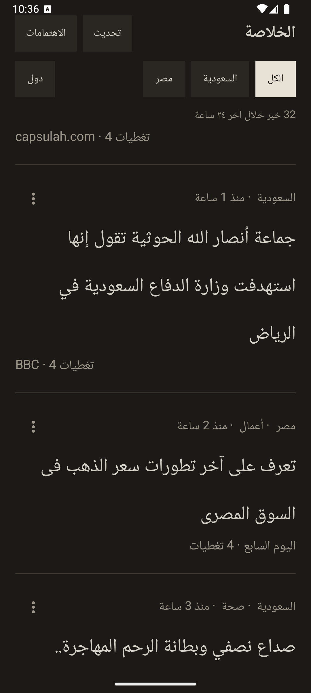
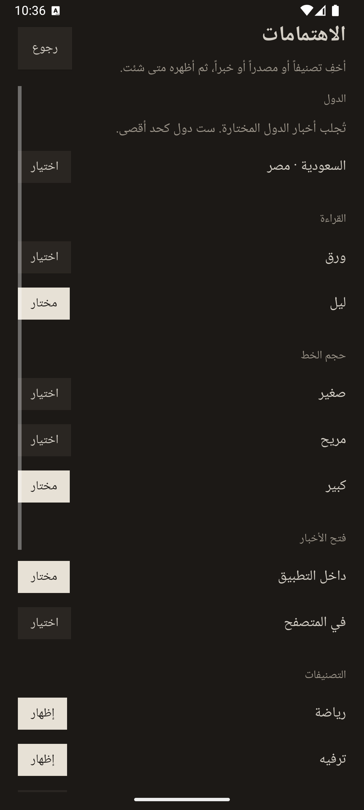

# الخلاصة

قارئ أخبار عربي بهاتفك. يجلب العناوين بنفسه من خلاصات Google News، بلا خادم وسيط.

An Arabic news reader for Android. It downloads Google News RSS on the phone. There is no backend.

<p align="center">
  
  
</p>

الشريط يعرض الدول التي تختارها، وحتى ست دول معاً. **دول** تفتح قائمة اختيار متعددة، وأول بند فيها **العالم أجمع**. **الكل** يجمع المختار. السحب للأسفل يحدّث القائمة، والضغط على العنوان يفتح الخبر داخل التطبيق. من **الاهتمامات** يمكن تبديل المظهر وحجم الخط وفتح الخبر في المتصفح، وإخفاء تصنيف أو مصدر أو خبر.

## التثبيت على أندرويد

يحتاج الجهاز إلى أندرويد ١٠ أو أحدث.

1. من صفحة [آخر إصدار](https://github.com/a0ali0taha/alkholasa/releases/latest) نزّل الملف `alkholasa.apk`.
2. افتح الملف. إذا منع النظام التثبيت، اسمح للمتصفح أو لتطبيق الملفات بتثبيت التطبيقات غير المعروفة.
3. ثبّت التطبيق وافتح **الخلاصة**.

هذا ملف تجربة موقّع بمفتاح التطوير، واسم الحزمة فيه `com.taha.alkholasa.debug`. يمكن حذفه من إعدادات التطبيقات في أي وقت.

## التطوير

يلزم Android Studio مع JDK ١٧ وحزمة Android SDK. عند فتح المشروع تنشئ الاستوديو ملف `local.properties` ومسار الـ SDK فيه. هذا الملف لا يُرفع إلى Git.

من مجلد المشروع:

```bash
export PATH="$HOME/Library/Android/sdk/platform-tools:$PATH"
./gradlew assembleDebug
adb install -r app/build/outputs/apk/debug/app-debug.apk
adb shell am start -n com.taha.alkholasa.debug/com.taha.alkholasa.MainActivity
```

التطبيق الأصلي `com.taha.alkholasa`، ونسخة التطوير تُثبَّت باسم `com.taha.alkholasa.debug`. الواجهة XML من اليمين إلى اليسار. لا تحوّلها إلى Compose إلا إذا طُلب ذلك. لا تضف خادماً محلياً ولا وسيط CORS: تطبيق أندرويد يقرأ الخلاصات مباشرة، والمتصفح هو الذي كان يحتاج وسيطاً.

- `NewsFeed.kt` يجلب خلاصة كل دولة، ويدمج العناوين المتطابقة.
- `CountryPicker.kt` قائمة الدول، بحد أقصى ست دول، ومنها العالم أجمع.
- `MainActivity.kt` الفلاتر والتحديث والقائمة.
- `NewsAdapter.kt` صف الخبر والتغطيات المرتبطة.
- `SettingsActivity.kt` المظهر والخط وطريقة فتح الخبر والاهتمامات.

## المساهمة

1. انسخ المستودع إلى حسابك (Fork).
2. أنشئ فرعاً للتغيير: `git checkout -b fix-headline-spacing`.
3. اجعل التغيير صغيراً وموضّحاً في الوصف: لماذا، لا قائمة ملفات فقط.
4. حافظ على العربية واتجاه اليمين إلى اليسار، وعلى ألوان الورق والليل الحالية.
5. افتح Pull Request إلى `master`.

اكتب بالعربية أو بالإنجليزية. صف السلوك الذي تغيّر وكيف جرّبته على جهاز أو محاكي.
